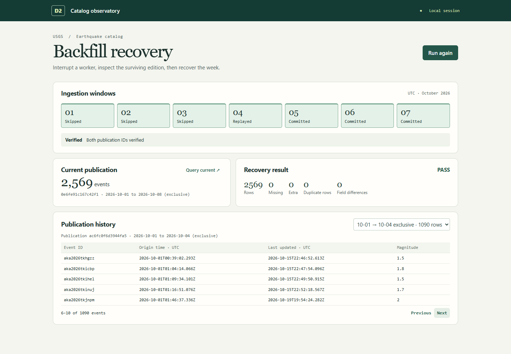

# D2 · Restartable earthquake catalog backfill

**[🟢 Open the live crash demo](https://puni344-earthquake-catalog-backfill.onrender.com/)** · [🎬 Four-minute walkthrough](docs/DEFENCE.md#four-minute-recording-script) · [📊 Measured results](#what-the-laptop-actually-demonstrated)

A stopped backfill can leave an earthquake report missing events even when its row count looks right. Analysts need to reproduce the exact extract a reader saw. This demo kills a real ingestion worker, compares the recovered week with an independently captured USGS response, and lets you inspect both published editions.

| 🟠 Interrupt | 🔵 Inspect | 🟢 Recover |
|---|---|---|
| Click **Run crash demo**. Watch the October 4 transaction roll back. | Click **Query current** while the worker is down. The three-day edition stays readable. | Click **Continue recovery**, inspect the week, then reopen the earlier edition under **Publication history**. |

[](https://puni344-earthquake-catalog-backfill.onrender.com/)

The hosted Linux demo gives each visitor a temporary SQLite database. Two drills can run at once and sessions expire after ten minutes. Allow about a minute for the free instance to wake. [Interruption screenshot](docs/evidence/dashboard-interruption.png) · [Deploy your own instance](https://render.com/deploy?repo=https://github.com/puni344/earthquake-catalog-backfill)

**Run locally** with `python -m earthquake.dashboard`, then open [the local dashboard](http://127.0.0.1:8765). A rerun or orderly shutdown removes its temporary database. The [offline CLI](#run-from-a-local-clone-in-five-minutes) and [publication history commands](#read-published-catalogs) use the same frozen fixture.

```text
USGS whole-week response ──► independent reference reader ────────────────┐
Seven daily responses ────► SQLite rows + per-day checkpoints ───────────┤ compare
                                                                        ▼
                                     immutable publications ◄── verified extract
                                        │              │
                                 current pointer     explicit ID
                                        └──── reader CLI ────► hash returned rows
```

### Run from a local clone in five minutes

Use Windows 11 x64 with PowerShell, Git for Windows, native 64-bit CPython **3.10.11** on PATH with its bundled SQLite **3.40.1**, and GNU Make **4.4.1**. The demo uses Python's standard library. Allow a writable fixed local volume under `%LOCALAPPDATA%\D2EarthquakeCatalog\state` outside the checkout and OneDrive, 896 MiB free there and 672 MiB available RAM within 75% of visible RAM. [Resource budget and checks](docs/evidence/M01-preflight.txt)

One-time setup on a Windows machine with App Installer (WinGet): install Git for Windows and the 64-bit Python 3.10.11 installer with **Add python.exe to PATH** selected if missing. Install GNU Make for the current user with the command below, then open a new PowerShell from the Start menu. These free prerequisites may require internet during setup. The demo itself runs offline. [Python installer](https://www.python.org/downloads/release/python-31011/) · [Git for Windows](https://gitforwindows.org/)

```powershell
winget install --id ezwinports.make --exact --version 4.4.1 --source winget --scope user --accept-package-agreements --accept-source-agreements --disable-interactivity
```

Clone this repository with `git clone https://github.com/puni344/earthquake-catalog-backfill.git`, enter it with `cd earthquake-catalog-backfill`, then check prerequisites and run:

```powershell
git --version
(Get-Command make).Source
make --version
python -c "import sys, sqlite3; print(sys.executable, sys.version, sqlite3.sqlite_version)"
make verify
$LASTEXITCODE
```

Look for **Live acquisition agreement: PASS**, **Frozen restart correctness: PASS**, **M08 PASS** and exit **0**. Make calls the direct entry point `python -m earthquake.verify`. Each invocation creates a fresh disposable database. Find the `paused-before` worker event, the three surviving checkpoints, zero October 4 rows and the resumed worker's skips. The `WITNESS` lines identify completed current reads during the outage and after commit. The final `BY-ID` lines show the returned counts and digests. [Integrated transcript](docs/evidence/quake-verify.txt)

### What the laptop actually demonstrated

Measurements below were taken on a Windows 11 laptop with an i5-1235U and 12 logical processors on 26 November 2026. Each row identifies the experiment that produced it. [Hardware](docs/evidence/quake-machine.txt)

| Run | Workload and measured result |
|---|---|
| [M02/M03 acquisition](docs/evidence/M03-reconcile.txt) | One whole week and seven daily HTTP responses for October 1–7. Both paths yielded 2,569 unique events with zero missing, extra, duplicate or changed projected values. |
| [M08 integrated worker crash](docs/evidence/quake-verify.txt) | 3.349 s. The October 4 pre-commit kill left zero target rows. Resume skipped three days and recovered 2,569 rows. All 23 current reads verified. Final IDs returned 1,090 and 2,569 rows. |
| [M06 publisher crash](docs/evidence/quake-publish.txt) | Four reader loops, 36 verified current reads. Forced exit after the pointer update and before commit. First verified new read took 935.782 ms from kill and 317.162 ms from retry. |
| [M07 normal publication under load](docs/benchmarks/README.md) | Three trials each at 1, 2 and 4 reader loops, eight timed CLI reads per loop. All 168 passed. Four loops delivered 12.73 reads/s, pooled p95 335.77 ms, peak sampled summed working set 125.22 MiB. |
| [M07 acquisition repair](docs/evidence/M07-orphan-remediation.txt) | After a worker kill, restarting the intact whole response went from one redundant request (1,839,817 bytes) to zero. All ten register entries passed after remediation. |
| [M09 clean clone](docs/evidence/M09-clean-clone.txt) | Candidate `a39b613`, fresh Windows PowerShell. Make exited 0 in 3.754 s wall time, including 3.283 s inside the verifier. All 24 current reads and both final lookups verified. |

The reference establishes agreement between two query paths for one captured week. The two publications cover different dates. Revision history of individual earthquakes, power-loss durability, multi-host failover, saturation and sustained throughput remain unverified. [Hosted Linux crash test](https://github.com/puni344/earthquake-catalog-backfill/actions/workflows/hosted.yml) · [Documentation CI](https://github.com/puni344/earthquake-catalog-backfill/actions/workflows/earthquake-docs.yml). [Accepted ADRs](docs/adr/README.md) · [Failure register](docs/failure-register.md) · [Interview materials and score](docs/DEFENCE.md) · [Project state](docs/PROJECT_STATE.md)

### Read published catalogs

The integrated verifier removes its disposable database when it exits. For a live walkthrough, run the following from the checkout root in a new PowerShell after installing the prerequisites above. The history drill creates a separate database under local state and prints its path. The final commands show the actual number of returned rows without printing thousands of events.

```powershell
$demo = make verify
if ($LASTEXITCODE) { throw 'Integrated demo failed' }
$demo | Select-String 'paused-before|Surviving checkpoints|WITNESS|Current reader outcomes|agreement:|correctness:|M08 PASS'

$historyRun = python -m earthquake.verify --drill history
if ($LASTEXITCODE) { throw 'History drill failed' }
$db = ($historyRun | Select-String 'history database=(.+) fixture=').Matches[0].Groups[1].Value
$publications = python -m earthquake.history --db $db list | ConvertFrom-Json
$publications | Select-Object id,start,end_exclusive,count
$current = python -m earthquake.history --db $db current | ConvertFrom-Json
$older = python -m earthquake.history --db $db get $publications[0].id | ConvertFrom-Json
$current,$older | Select-Object id,@{Name='ReturnedRows';Expression={$_.rows.Count}}
```

Listing returns metadata in first-publication order. Current and named reads return JSON containing the ID, half-open UTC coverage, source hashes and event rows. An empty catalog lists as `[]`. Reading current before the first publication or requesting an unknown ID writes a diagnostic to stderr and exits 2.

[MEASURED – M05, 26 November 2026] The 1–3 October extract contained 1,090 rows. Extending coverage through 7 October yielded 2,569. Looking up the shorter publication afterward reproduced its original rows. [IDs, commands and returned-row digests](docs/evidence/M05-history.txt)
